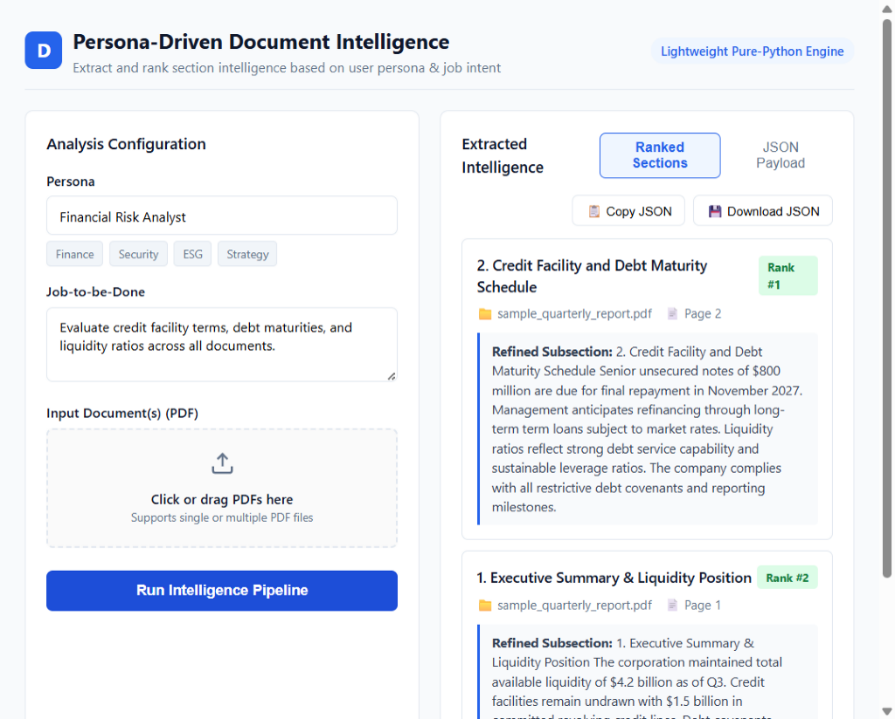
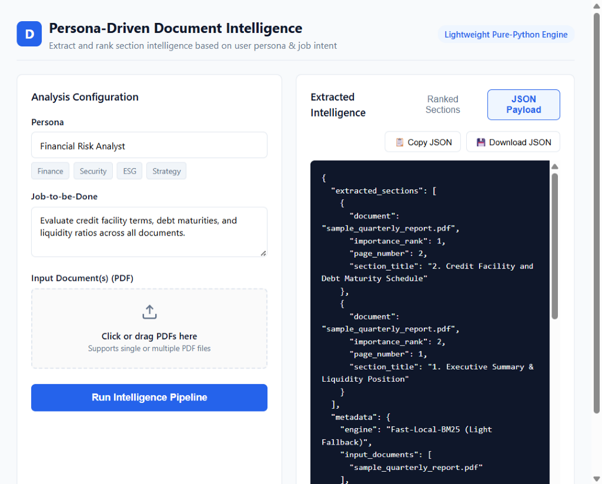
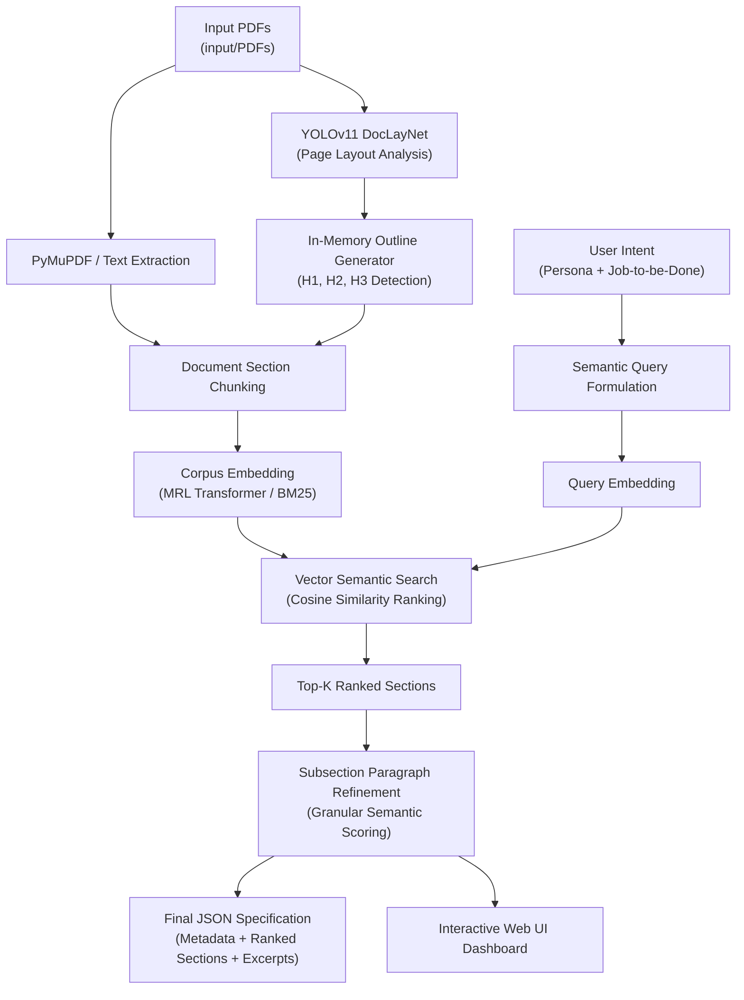

# Persona-Driven Document Intelligence (Challenge 1B)

An intelligent document analysis and extraction system that prioritizes, semantically ranks, and extracts relevant document sections across collections of multi-page PDFs tailored to a specific **Persona** and **Job-to-be-Done**.

Originally developed for **Adobe India Hackathon (Challenge 1B)**, this system integrates document layout analysis (YOLOv11 DocLayNet) with dense semantic search (Sentence Transformers MRL) and features both a **high-throughput containerized CLI pipeline** and an **interactive lightweight Web UI**.

---

## Interactive Web UI

The repository includes a self-contained, lightweight Web interface with zero frontend dependencies (pure HTML/CSS/JS served via Flask).

| Ranked Sections View | JSON Payload Inspector |
| :---: | :---: |
|  |  |

---

## Key Features

- **Persona & Intent-Aware Ranking:** Concatenates user persona and task intent into semantic vector queries to prioritize sections that matter most to the specific stakeholder (e.g., Financial Risk Analyst vs. Cybersecurity Auditor).
- **Integrated Layout & Outline Detection (1A Processing):** Leverages a YOLOv11s DocLayNet model to detect page titles, Section-headers, and hierarchy ($H_1, H_2, H_3$) directly from document pixmaps.
- **Batched Multi-Page Inference:** Executes document layout detection across all pages of a PDF in unified batches, minimizing GPU/CPU context switches.
- **Resource-Constrained Optimization:** Utilizes `static-similarity-mrl-multilingual-v1`, an embedding model with Matryoshka Representation Learning (MRL) and static embeddings optimized for asymmetric search under constrained CPU and RAM limits.
- **Deep Subsection Refinement:** Extracts and re-ranks individual paragraphs within top-ranked sections, stripping bullet noise to surface high-signal excerpts.
- **Dual Runtime Support:**
  - **Full ML Engine:** YOLOv11 + PyMuPDF + Sentence Transformers inside Docker.
  - **Instant Local Fallback:** Pure-Python BM25 + PyPDF engine in `app.py` for immediate execution without downloading multi-gigabyte PyTorch binaries.

---

## Architecture & Pipeline



---

## How to Build and Run

### Option 1: Interactive Web UI (Instant Local Run)

Run the lightweight web interface on your host machine:

```bash
# 1. Start the Flask server
python app.py

# 2. Open in your browser
# http://localhost:5000
```

- Upload one or more PDFs (or click Run to test with the built-in sample financial report).
- Choose presets (Finance, Cybersecurity, ESG, Strategy) or enter custom roles.
- Inspect ranked sections, refined paragraphs, and export the output JSON directly.

---

### Option 2: Containerized Batch CLI Pipeline (Docker)

#### 1. Directory Structure

Place your input documents and JSON request into `input/`:

```
input/
  input.json         # Challenge input JSON (persona, job, document list)
  PDFs/              # Directory containing target PDF files
output/              # Output directory for results
models/              # Model weights (tracked with Git LFS)
  yolov11s-doclaynet.pt
  static-similarity-mrl-multilingual-v1/
```

#### 2. Build the Docker Image

```bash
docker build --platform linux/amd64 -t persona-driven-doc-intel:latest .
```

#### 3. Run the Container

Run with `--network none` as required for offline evaluation:

```bash
docker run --rm \
  -v "$(pwd)"/input:/app/input \
  -v "$(pwd)"/output:/app/output \
  --network none \
  persona-driven-doc-intel:latest \
  python process_pdfs_1b.py /app/input/input.json /app/output
```

The resulting JSON output (e.g., `challenge1b_output.json`) will be written to `output/`.

---

## Output JSON Schema

The pipeline produces the standardized output format:

```json
{
  "metadata": {
    "input_documents": ["annual_report_2024.pdf"],
    "persona": "Financial Risk Analyst",
    "job_to_be_done": "Evaluate credit facility terms and debt maturities",
    "processing_timestamp": "2026-11-23T10:14:00"
  },
  "extracted_sections": [
    {
      "document": "annual_report_2024.pdf",
      "page_number": 42,
      "section_title": "Credit Facility and Debt Maturity Schedule",
      "importance_rank": 1
    }
  ],
  "subsection_analysis": [
    {
      "document": "annual_report_2024.pdf",
      "page_number": 42,
      "refined_text": "Senior unsecured notes of $800 million are due for final repayment in November 2027. Management anticipates refinancing through long-term term loans..."
    }
  ]
}
```

---

## Models and Technical Stack

| Component | Technology | Rationale |
| :--- | :--- | :--- |
| **Page Layout Detection** | YOLOv11s DocLayNet | High-speed object detection for document layout elements (Titles, Section-headers). |
| **Text Parsing & Rendering** | PyMuPDF (`fitz`) / `pypdf` | Rapid C-level PDF parsing and page-to-image pixmap rendering. |
| **Semantic Embeddings** | `static-similarity-mrl-multilingual-v1` | Fast CPU static embeddings using Matryoshka Representation Learning (MRL). |
| **Ranking & Search** | `sentence-transformers.util.semantic_search` | Scalable cosine similarity matrix multiplication over corpus embeddings. |
| **Containerization** | Docker (`python:3.10-slim`) | Self-contained, zero-network execution environment for air-gapped reproducibility. |
| **Web Dashboard** | Flask + Vanilla HTML5/CSS3 | Zero-overhead lightweight UI with live JSON export and preset configurations. |
